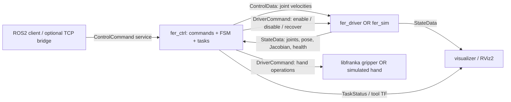
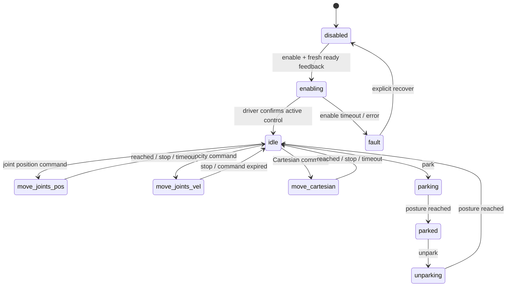

# FER architecture

## Mapping from the reference systems

| Undroid ROS1 component | FER ROS2 component |
| --- | --- |
| `undroid_msgs` | `fer_msgs`, rosidl interfaces, seven joints and SI units |
| `robot_model` / `UndroidArmModel` | `fer_model::PandaModel`; hardware uses the live libfranka model |
| `undroid_ctrl::KinematicController`, commands, states | `fer_ctrl::Controller`, `commands::Command`, `states::State`; ROS-independent core wrapped in `rclcpp::Node` |
| `undroid_driver` | `fer_driver/driver_node`, direct FCI joint velocities |
| Simulated driver | `fer_sim/simulator_node`, identical state/control/services |
| `undroid_sim` visualization | `fer_sim/visualizer_node` and RViz2 |
| `undroid_tcp_bridge` | Optional `fer_tcp_bridge`, JSON-lines protocol |
| ROS1 launch and libconfig | Python ROS2 launch and declared YAML parameters, following Ulisse's package layout |

The FSM and task roles match Undroid's architecture. The implementation is
self-contained: joint-limit velocity dampers constrain joint position, joint
velocity, and damped Cartesian inverse-kinematic tasks. A lower-priority posture
term centers the redundant seventh joint through the damped null-space projector.
This is not the external TPIK/iCAT solver: damping makes priorities approximate,
and there is no task-file loader, task activation framework or obstacle planner.
It offers a compact extension point in `Controller::update()` without requiring
the reference projects' private libraries.

## State machine

Motion commands can replace a running motion after validation. A rejected command
does not mutate the active goal. `disable` is accepted in every state. Feedback
loss disables the controller; driver errors fault it. Neither restored feedback
nor successful recovery restarts motion. `parked` requires `unpark` before another
motion. Park/unpark are joint-space movements, not Franka firmware operations.

Joint goals must fit the seven Panda limits plus `joint_margin`. Velocity
commands must fit the configured maximum. Cartesian requests accept base-frame
absolute poses, base-relative offsets, or EE-relative transforms. RPY uses
`Rz(yaw) Ry(pitch) Rx(roll)`. For a relative BASE request, position is incremented
in base coordinates and the delta rotation premultiplies the current rotation;
for relative EE, the delta transform postmultiplies the current tool transform.

## Realtime boundary

The arm node's single ROS executor produces a fixed-size command record. A
dedicated worker owns **all** `franka::Robot` and `franka::Model` operations,
including `readOnce`, `loadModel`, `control`, and `automaticErrorRecovery`.
Only explicit enable requests start control; automatic recovery is never invoked
as part of an error handler. While disabled, the worker polls measured state.

During `Robot::control`, libfranka invokes the velocity generator at 1 kHz. It
consumes the latest command, checks a steady-clock watchdog, records feedback,
and returns `JointVelocities`. There are no ROS publications, logging calls,
heap allocations, or mutex acquisitions in the callback. Two SPSC triple buffers
transfer fixed-size records without blocking. All operations on each mailbox
have one producer and one consumer; do not replace the single ROS executor with
a multithreaded executor without maintaining that constraint.

The driver enables libfranka's built-in rate limiter and standard 100 Hz low-pass
filter. On disable, shutdown or watchdog expiry, it requests zero velocity, waits
for the commanded velocity/acceleration to settle, and returns `MotionFinished`.
A watchdog expiry latches a fault. Exceptions end the current control session and
are exposed through feedback; the next enable requires explicit recovery.
Connection loss requires restarting the node. No collision thresholds, payload,
impedance, end-effector transforms or firmware safety configuration are changed.

ROS publishes only newly received snapshots. Feedback and velocity-command
timeouts use `steady_clock`, independent of ROS time. The controller and driver
have separate watchdogs, so loss of either stream cannot leave a velocity command
running indefinitely. `max_joint_velocity` must be consistent in controller and
backend YAML files; a backend rejects larger requests.

The gripper has its own node and libfranka connection, with a multithreaded
executor so `stop` remains callable during a blocking move/grasp. No gripper
operation runs in the arm's realtime callback. The controller forwards driver
requests asynchronously and never waits on a service inside an executor callback.

The [official Robot API](https://frankarobotics.github.io/libfranka/0.15.0/classfranka_1_1Robot.html)
documents the 1 kHz callback contract; the
[Gripper API](https://frankarobotics.github.io/libfranka/0.15.0/classfranka_1_1Gripper.html)
documents the independent, thread-safe hand operations.

## ROS graph

All names are relative to the launch namespace (`/fer` by default):

| Name | Type | Purpose |
| --- | --- | --- |
| `srv/control_command` | `fer_msgs/srv/ControlCommand` | Operator command acceptance |
| `driver/command` | `fer_msgs/srv/DriverCommand` | Arm enable/disable/recovery acceptance |
| `gripper/command` | `fer_msgs/srv/DriverCommand` | Hand move/grasp/home/stop |
| `state/state_data` | `fer_msgs/msg/StateData` | Seven joints, live TCP/Jacobian, health |
| `ctrl/ctrl_data` | `fer_msgs/msg/ControlData` | FSM state, enabled intent, seven velocity references |
| `ctrl/task_status` | `fer_msgs/msg/TaskStatus` | Current action, errors, limit-damper activity |
| `joint_states` | `sensor_msgs/msg/JointState` | Standard arm joint feedback |
| `gripper/state` | `fer_msgs/msg/GripperState` | Width, grasp flag, busy flag and error |
| `visualization/arm` | `visualization_msgs/msg/Marker` | Simplified arm line geometry |
| `/tf` | `tf2_msgs/msg/TFMessage` | Measured base-to-tool transform |

Feedback uses sensor-data QoS with depth one. Velocity references use reliable
QoS with depth one. Services acknowledge acceptance; motion completion is the
transition back to idle/parked. The physical gripper service returns after its
operation; the controller's public service queues it and reports errors through
the gripper state and ROS logs. During a gripper move its width is the last
measured width, with its original timestamp and `busy=true`.

Namespacing separates ROS names. When running multiple arms, also configure
distinct `base_frame` and `tool_frame` values because TF frame IDs are global.
The included RViz arm geometry is a kinematic line model rather than a mesh or
collision model.
