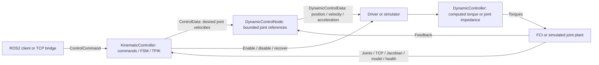
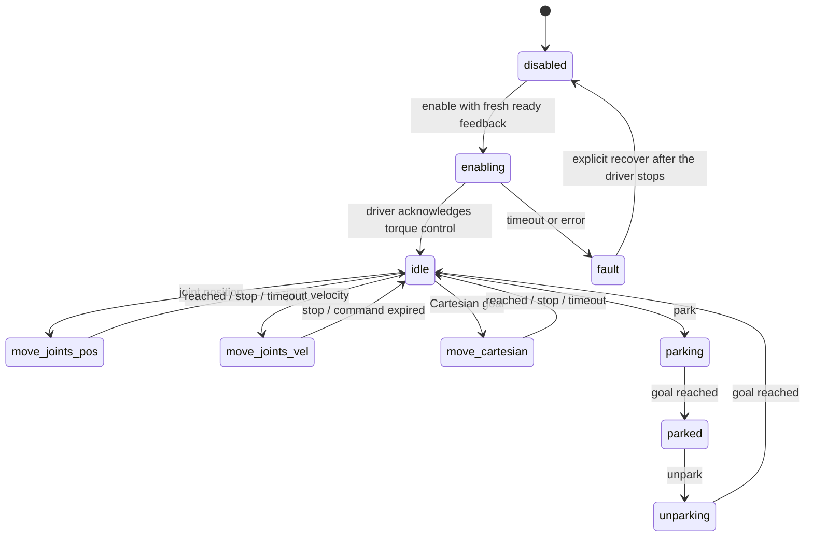

# FER control architecture

The implementation follows Undroid's command/state/task organization and Ulisse's
ROS2 package and node layout.

## Components

| Role | Implementation |
| --- | --- |
| Kinematic ROS node | `fer_ctrl::KinematicController` |
| Command/state/task core | `fer_ctrl::TaskPriorityController`, `fsm::FSM` |
| Task and action solver | IKCL tasks, `tpik::ActionManager`, `tpik::iCAT`, `tpik::Solver` |
| Kinematic configuration | `fer_ctrl/conf/kcl_fer.conf` |
| ROS dynamic reference generator | `fer_ctrl::DynamicControlNode`, `JointReferenceGenerator` |
| Realtime dynamic control law | `fer_ctrl::DynamicController` |
| Dynamic configuration | `fer_ctrl/conf/dcl_fer.conf` |
| Hardware backend | `fer_driver::FrankaDriver`, `franka::Robot`, `franka::Model` |
| Simulation backend | `fer_sim::Simulator`, same dynamic-controller library |
| Robot model | `fer_model::FrankaArmModel` for RML, `PandaModel` for simulation |



## Task-priority configuration

`kcl_fer.conf` retains the reference file's `tasks`, `priorityLevels`,
`actions`, and `states` sections. Tasks are constructed in `SetUpTasks()`,
configured by `ConfigureTasksFromFile()`, grouped by
`ConfigurePriorityLevelsFromFile()`, and selected through
`ConfigureActionsFromFile()`.

The registered tasks are:

| Task | Role |
| --- | --- |
| `JointsLimit` | Seven-joint inequality task with configurable activation intervals |
| `ObstacleAvoidance` | Signed distances from the TCP to configured planes |
| `JointsPosition` | Joint position tracking |
| `JointsVelocity` | Joint velocity tracking |
| `ToolCartesianDistance` | Cartesian translation |
| `ToolCartesianOrientation` | Cartesian orientation |
| `JointsPosture` | Lower-priority redundant posture, using `unparkedJointsPos` |

The file order of `priorityLevels` defines TPIK's unified priority order.
An action lists its participating levels in that order. Levels can combine
multiple tasks. The default motion actions place joint limits and plane
avoidance above the motion objective; `MoveTool` also includes a posture level.

The configuration loader rejects missing or unknown tasks, bad vector lengths,
duplicate levels/actions, unknown references and inconsistent action ordering.
New task classes are registered in `SetUpTasks()`; changing their gains,
enable flags, saturations, priority grouping or action membership is done in
the configuration file.

Plane normals point toward the allowed half-space:
`normal.dot(toolPosition) + offset >= clearance`. The default plane is the
table at base-frame z=0.10 m. Activation bounds contain one value per plane.
The plane task uses signed distance and its matching Jacobian so it also points
toward the safe side on or below the plane. This is TCP plane avoidance; it does
not provide full-arm collision checking or path planning.

The installed IKCL version's `JointsLimit` loader omits its inherited enable
flag. A small derived task applies that flag after the standard IKCL
configuration. The source libraries are not modified.

RML joint origins and the standalone Panda model are checked against each other.
The driver reports `F_T_EE`; the RML tool attachment is updated from it, including
the fixed 0.107 m joint-7-to-flange transform.

## Commands and states

Each command and state has a header and implementation file under
`fer_ctrl/{include,src}/fer_ctrl/{commands,states}`. Commands validate goals
before changing `RobotInfo`. The FSM controls allowed commands and transitions;
states select configured actions and update task references.



Disable and stop remain available when feedback is stale. Stop preserves the
parked state and cancels a pending enable. Idle and parked request zero velocity.
A rejected motion request leaves the active goal unchanged. Restored feedback
or recovery does not re-enable control.

Cartesian RPY uses `Rz(yaw) Ry(pitch) Rx(roll)`. Absolute poses use BASE.
Relative BASE requests add translation in base coordinates and premultiply the
current rotation; relative EE requests postmultiply the current tool transform.
Joint requests use indices 0..6 and SI units.

## Dynamic controller

The ROS dynamic node generates bounded position, velocity and acceleration
references from KCL velocities. It applies acceleration/jerk limits and limits
integrated position error relative to measured joints. It resets the reference
while disabled or waiting for the driver's acknowledgement.

The actual torque law runs with current state and model data in the driver's
libfranka callback. With position error `e = q_ref - q` and velocity error
`de = dq_ref - dq`:

```text
ComputedTorque:
    tau = M(q) * (ddq_ref + Kp * e + Kd * de) + coriolis(q, dq)

JointImpedance:
    tau = Kp * e + Kd * de + coriolis(q, dq)
```

The controller checks finite data and positive-definite inertia, bounds position
error, and applies per-joint torque and torque-rate limits. Gravity is excluded
from the commanded torque because FCI compensates it internally. The reference
generator and dynamic control law share `dcl_fer.conf`; top-level launch passes
the same file to the dynamic node and backend.

The [official libfranka impedance example](https://github.com/frankarobotics/libfranka/blob/0.9.2/examples/joint_impedance_control.cpp)
illustrates the torque/Coriolis convention and realtime callback use.

## Realtime boundary and watchdogs

One worker owns all `franka::Robot` and `franka::Model` operations.
ROS callbacks only transfer fixed-size references and service intent.
Two single-producer/single-consumer triple buffers exchange commands and
feedback without blocking.

`TorqueControlCB()` reads current joints, mass, Coriolis and Jacobian, computes
torques, and returns `franka::Torques` at 1 kHz. The callback has no ROS
publications, logging or mutex acquisition; the dynamic law uses fixed-size
Eigen matrices. The driver enables libfranka's rate limiting and 100 Hz filter.

On disable, shutdown, or stale dynamic references, the worker latches stopping
and generates a local deceleration reference. It waits for the reference and
measured velocity to settle before returning `MotionFinished`. Invalid model
data and stop timeouts end the session and latch an error. No previous motion
resumes without an explicit enable; watchdog errors require explicit recovery.

Each stage has a steady-clock watchdog:

1. KCL disables on missing robot feedback.
2. DCL disables on stale KCL commands or feedback.
3. The driver stops on stale DCL references.

Only newly received feedback snapshots are published. TPIK transition timing is
fed from the same monotonic clock, including deterministic time in unit tests.
The driver does not change collision thresholds, payload or end-effector settings.
Connection loss requires restarting the driver.

The gripper uses an independent libfranka connection and multithreaded executor,
so stop can interrupt a blocking move or grasp. Its ROS operations do not enter
the arm's realtime callback.

## ROS interfaces

All names below are relative to the namespace, normally `/fer`:

| Name | Type | Purpose |
| --- | --- | --- |
| `srv/control_command` | `fer_msgs/srv/ControlCommand` | Operator commands |
| `driver/command` | `fer_msgs/srv/DriverCommand` | Arm enable/disable/recovery |
| `gripper/command` | `fer_msgs/srv/DriverCommand` | Gripper operations |
| `ctrl/ctrl_data` | `fer_msgs/msg/ControlData` | KCL state and velocities |
| `ctrl/dynamic_control` | `fer_msgs/msg/DynamicControlData` | DCL joint references |
| `ctrl/tpik_action` | `fer_msgs/msg/TPIKAction` | Current action and ordered levels/tasks |
| `tasks/<task name>` | `fer_msgs/msg/TaskStatus` | Task enable, membership, activations and reference rate |
| `ctrl/task_status` | `fer_msgs/msg/TaskStatus` | Motion-error summary |
| `state/state_data` | `fer_msgs/msg/StateData` | Joints, TCP, Jacobian, dynamics, torques and health |
| `joint_states` | `sensor_msgs/msg/JointState` | Standard arm feedback |
| `gripper/state` | `fer_msgs/msg/GripperState` | Gripper measurement and operation status |
| `visualization/arm` | `visualization_msgs/msg/Marker` | Simplified arm geometry |
| `/tf` | `tf2_msgs/msg/TFMessage` | Measured base-to-tool transform |

Feedback uses sensor-data QoS with depth one; references use reliable QoS with
depth one. Services report acceptance, with completion observed through state.
KCL forwards driver requests asynchronously.

Namespaces separate ROS names. Multiple arms also require distinct base/tool
frame IDs and matching frame parameters across their nodes.

## Simulator

The simulator consumes the same DCL reference messages and evaluates the same
dynamic law. Its plant uses configurable diagonal joint inertia and viscous
damping, with gravity compensation assumed. This validates torque tracking and
watchdogs without hardware. It does not reproduce full Panda dynamics,
contacts, collision geometry, or grasped objects.
